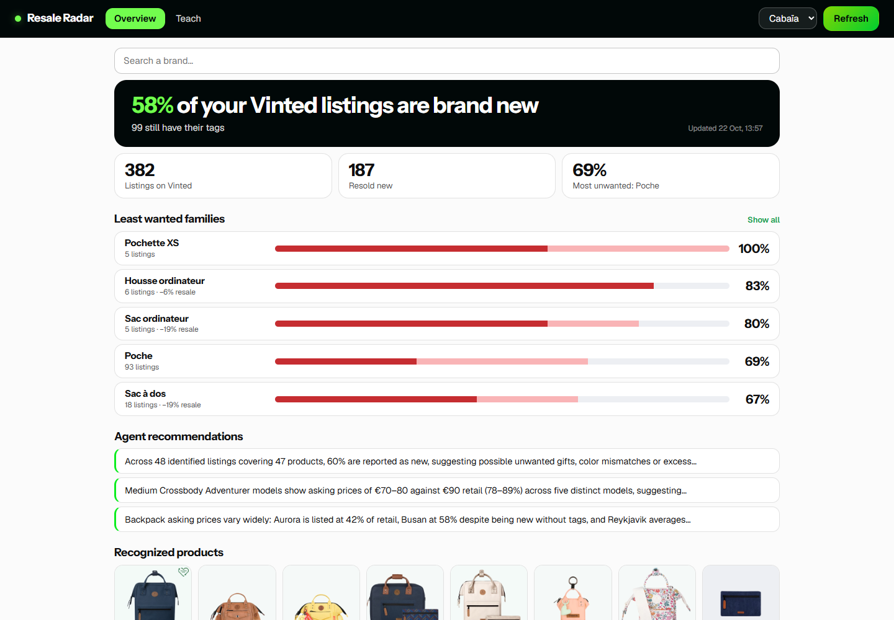
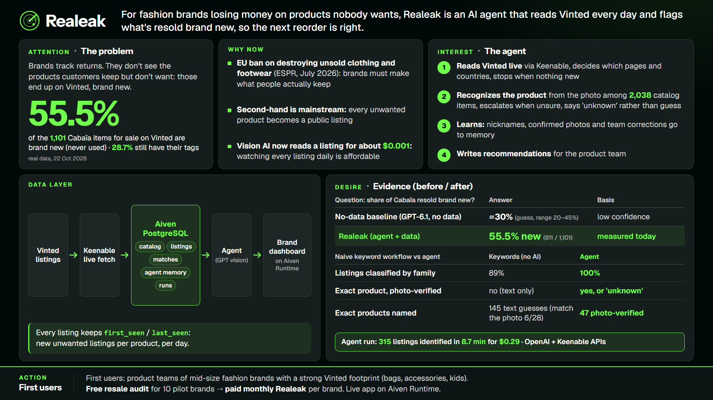
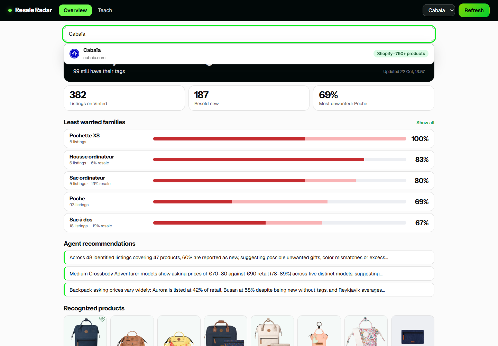
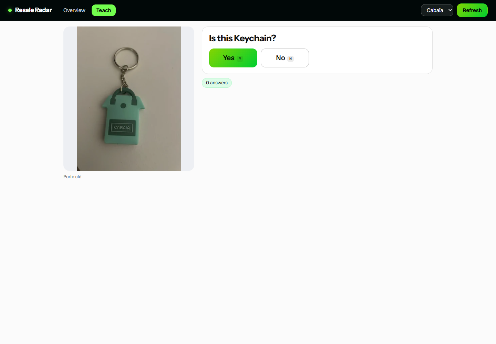

# Realeak

**For fashion brands losing money on products nobody wants, Realeak is an AI agent that reads Vinted every day and flags what's resold brand new, so the next reorder is right.**

- Live demo: https://01a1634d-3d18-7dfd-bd64-7fe0e4f1f7ea-8080.eur-1.aiven.app
- One-page pitch: https://01a1634d-3d18-7dfd-bd64-7fe0e4f1f7ea-8080.eur-1.aiven.app/slide





## Use cases

**1. Which of my products do customers resell brand new?**
A product manager opens the Overview and sees that 57.8% of the Cabaïa items listed on Vinted are brand new, 30.5% still with their tags. The "Least wanted families" ranking shows where it hurts: the "Poche" family is resold new 69% of the time. None of this appears in a return rate, because these customers kept the product and quietly put it up for sale.

**2. Search any brand.**
Type a brand name: the app finds its official site and favicon, then detects whether it is an online shop (Shopify, WooCommerce, ...) or answers "Not an e-commerce brand". It is the entry point to onboard the next brand.



**3. Teach the agent.**
In the Teach tab the agent shows a Vinted photo and asks "Is this Keychain?". Answer Yes or No: the answer is stored in memory and reused as a reference at the next refresh, so the agent gets better with use.



## How it works

The agent runs four steps, each reading from and writing to PostgreSQL:

1. **Collect**: fetches the latest Vinted brand pages (FR, DE, and more) live through the [Keenable](https://keenable.ai) Fetch API. If a country page times out, the agent switches to another country on its own. Seller identities are never stored: a listing is keyed by its photo id.
2. **Identify**: matches each listing to the brand's catalog (public Shopify feed) **by photo**, using OpenAI vision models. A fast model (`gpt-6-luna`) shortlists, a stronger one (`gpt-6.1-sol`) arbitrates on hard cases (escalation). When the photo does not support a match the answer is `unknown`, never a guess.
3. **Learn**: confirmed matches, title aliases and your Yes/No answers go to a `memory` table and become reference images for the next run.
4. **Explain**: writes the insights shown in the app (most unwanted families, price gaps against retail, recommendations).

```
Brand catalog (Shopify products.json) ----------------+
                                                      v
Vinted brand pages --> Keenable Fetch API --> [Aiven PostgreSQL]
                                              products | listings | matches
                                              memory   | labels   | runs
                                                  ^          |
                                   reads/writes   |          v
                          [AI agent: collect -> identify -> learn -> explain]
                                                  |   (OpenAI API + Keenable API)
                                                  v
                          [FastAPI app on Aiven Runtime] --> product manager
                          (Overview, brand search, Teach the agent, Refresh)
```

The agent calls the OpenAI API and the Keenable API. "Refresh" in the UI creates a run row in PostgreSQL and streams its progress into `runs.log`.

## Evidence

Measured on 22 Oct 2026 on real public data (Cabaïa catalog: 2,038 products; 315 latest Cabaïa listings on Vinted FR + DE). Full write-up: [`deliverables/benchmark-before-after.md`](deliverables/benchmark-before-after.md).

- **No data vs data**: asked the same question without data, the model guessed "about 30%" new (range 20 to 45%). Realeak measured **57.8%** (182 of 315 listings), every listing traceable in the database.
- **Keywords vs agent**: a keyword workflow classifies 89% of listings into a family and proposes an exact product for 145 of them from the title text only. The agent classifies **100%** of families and names an exact product for 47 listings **verified on the photo**, flagging the rest as `unknown`.
- **Time and cost**: 315 listings read and classified in **8.7 minutes for $0.29** (about $0.001 per listing).

## Setup

Requires Python 3.11+.

```bash
git clone <this-repo-url> resale-radar
cd resale-radar
python -m venv .venv
source .venv/bin/activate          # Windows: .venv\Scripts\activate
pip install -r requirements.txt
```

Create a `.env` file at the repo root (names only, fill in your own values):

```
DATABASE_URL=            # optional: PostgreSQL URL; defaults to a local SQLite file (data.db)
OPENAI_API_KEY=
OPENAI_MODEL_FAST=       # e.g. gpt-6-luna
OPENAI_MODEL_SMART=      # e.g. gpt-6.1-sol
KEENABLE_API_KEY=
LLM_BACKEND=openai
AGENT_MAX_LISTINGS=      # optional: caps the listings per run
AGENT_MODE=              # optional: "queue" to only queue runs, then run `python -m app.worker`
```

First data load, then start the app:

```bash
uvicorn app.main:app --reload --port 8080
# in another terminal: load the Cabaïa catalog
curl -X POST http://localhost:8080/api/catalog/cabaia/load
# then click "Refresh" in the UI, or:
curl -X POST http://localhost:8080/api/agent/cabaia/run
```

Open http://localhost:8080. The tests and the benchmark:

```bash
python -m pytest -q
python -m app.bench --brand cabaia     # keywords vs agent vs agent + memory, scored on your Teach answers
```

## Deploy on Aiven Runtime

The repo ships a `Dockerfile` (Python 3.11, `EXPOSE 8080`, serves `app.main:app`).

1. In the Aiven console, open **Runtime > Deploy application** and connect this GitHub repository.
2. Integrate your Aiven for PostgreSQL service: it injects `DATABASE_URL` into the application.
3. Add `OPENAI_API_KEY`, `OPENAI_MODEL_FAST`, `OPENAI_MODEL_SMART`, `KEENABLE_API_KEY` and `LLM_BACKEND=openai` as **secrets** (environment variables).
4. Click **Deploy latest commit**. Tables are created on startup.

## API

| Method | Endpoint | What it does |
|---|---|---|
| GET | `/` , `/slide` | Web app, one-page pitch |
| GET | `/api/health` | Health check |
| GET | `/api/brands/search?q=` | Official site, favicon and e-commerce detection for any brand |
| POST | `/api/catalog/{brand}/load` | Load the brand's public Shopify catalog |
| POST | `/api/collect/{brand}` | Collect Vinted listings (`countries`, `pages`) without the agent |
| POST | `/api/agent/{brand}/run` | Start an agent run, returns a `run_id` |
| GET | `/api/runs`, `/api/runs/{run_id}` | Run history, live progress log |
| GET | `/api/report/{brand}` | Overview figures: share new, families, recommendations |
| GET | `/api/categories`, `/api/listings`, `/api/products` | Families, listings and catalog products |
| GET | `/api/labels/next` | Next listing to ask about (Teach the agent) |
| POST | `/api/labels` | Save a Yes/No answer to memory |
| GET | `/api/labels/count` | Number of answers given |

## Project structure

```
app/
  main.py        FastAPI routes
  agent.py       the agent: collect, identify, learn, explain
  keenable.py    Keenable Search / Fetch client
  collect.py     Vinted listing collection (FR, DE, NL, IT, ES, BE)
  catalog.py     Shopify catalog loader and supported brands
  brands.py      live brand search and e-commerce detection
  worker.py      optional queue worker (AGENT_MODE=queue)
  bench.py       benchmark: keywords vs agent vs agent + memory
  db.py          SQLAlchemy layer (PostgreSQL, SQLite fallback)
static/          index.html (app), slide.html (pitch)
tests/           offline tests (agent, bench, brands, queue)
scripts/         sqlite_to_pg.py (copy a local DB to PostgreSQL)
deliverables/    benchmark, video script, slide
docs/screenshots/
Dockerfile
```
